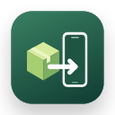
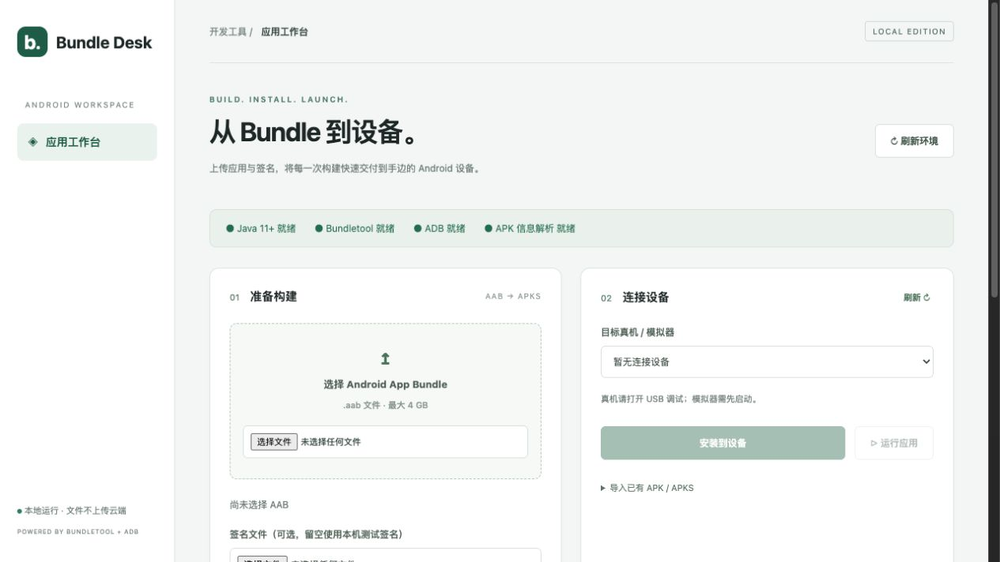

  
  <h1>Bundle Desk</h1>
  
<strong>从 Android Bundle 到设备，把终端命令变成可视化工作台。</strong>

  
AAB → APKS · APK / APKS 安装 · 应用启动 · 包信息解析

  

    
    
    
    
  

  
<a href="https://github.com/WayneZ01/bundle-desk/releases/latest">下载安装包</a> · <a href="#快速开始">快速开始</a> · <a href="docs/DEVELOPMENT.md">开发与构建</a> · <a href="https://github.com/WayneZ01/bundle-desk/issues">反馈问题</a>

## 为什么做这个工具

AAB 不能像 APK 一样直接安装到手机。开发测试中，经常需要寻找 bundletool、配置 Java、填写签名参数、检查 ADB 设备，再执行转换、安装和启动命令。

Bundle Desk 将这条流程整理成一个本地界面。选择文件、按需提供签名、转换 APKS、选择设备、安装并运行；需要确认安装包内容时，可以在同一处查看并导出应用信息。

所有包文件都在本机处理。发行包内置运行工具，不要求使用者安装 Android Studio、Homebrew 或手动配置 PATH。

## 当前功能

| 能力 | 说明 |
| --- | --- |
| AAB 转 APKS | 通用模式无需连接设备；设备模式按所选真机或模拟器生成 |
| 自定义签名 | 支持上传 JKS、keystore、P12/PFX，填写别名及密码 |
| 默认测试签名 | 不提供签名库时自动生成，后续在同一电脑持续复用 |
| 直接导入 APK / APKS | 不需要原始 AAB，可直接查看信息并安装 |
| 保留已有签名 | 有效签名 APK 直接安装；未签名 APK 安装前使用默认测试签名 |
| 设备列表 | 识别 ADB 在线、未授权、离线状态，可选择目标设备 |
| 安装与启动 | 安装到所选设备，按解析出的包名或手动输入的包名启动 |
| 应用档案 | 包名、版本、SDK、权限、名称、图标及更多可提取信息 |
| 执行日志 | 查看工具输出及安装错误，不自动卸载已有应用 |
| 导出 | 保存生成的 APKS，导出应用信息 JSON，清理本次会话文件 |

## 下载与平台

从 [Releases](https://github.com/WayneZ01/bundle-desk/releases) 下载完整 ZIP。普通使用者不需要克隆源码。

| 发行包 | 平台 | 启动方式 | 状态 |
| --- | --- | --- | --- |
| [Bundle-Desk-v1.0.1-macos-arm64.zip](https://github.com/WayneZ01/bundle-desk/releases/download/v1.0.1/Bundle-Desk-v1.0.1-macos-arm64.zip) | macOS 12+ · Apple Silicon | 打开 `Bundle Desk.app` | **已验证可用** |
| [Bundle-Desk-v1.0.1-html-macos-arm64.zip](https://github.com/WayneZ01/bundle-desk/releases/download/v1.0.1/Bundle-Desk-v1.0.1-html-macos-arm64.zip) | macOS 12+ · Apple Silicon | 双击 `启动 HTML 版.command` | **已验证可用** |
| [Bundle-Desk-v1.0.1-windows-x64.zip](https://github.com/WayneZ01/bundle-desk/releases/download/v1.0.1/Bundle-Desk-v1.0.1-windows-x64.zip) | Windows 10/11 · x64 | 双击 `Start-BundleDesk.cmd` | 已打包；待 Windows 实机反馈 |

Mac 应用版使用原生窗口；HTML 版和 Windows 便携版使用默认浏览器与本地服务。HTML 版不能只复制 `index.html` 使用。当前没有 Intel Mac 发行包、Windows ARM64 发行包、安装器或自动更新功能。

Mac 应用当前采用 ad-hoc 签名，尚未使用 Apple Developer ID 公证；它与 Android APK 的签名是两回事。下载后请按系统的正常应用打开流程操作。

## 快速开始

### 1. 解压并启动

**macOS 应用版**：完整解压，打开 `Bundle Desk.app`，也可将其拖入“应用程序”。

**macOS HTML 版**：完整解压，双击 `启动 HTML 版.command`，浏览器自动打开工作台；使用期间保持启动终端开启。

**Windows 版**：完整解压，双击 `Start-BundleDesk.cmd`，浏览器自动打开工作台。使用期间保留启动窗口，完成后关闭或按 Ctrl+C。可运行 `Create-Desktop-Shortcut.cmd` 创建带图标的桌面快捷方式。

不要在压缩包预览中启动，也不要单独移动启动文件。工具通过本地随机端口运行，完整依赖必须与启动器一起保留。

### 2. 选择你的文件

| 你手里的文件 | 操作 |
| --- | --- |
| 只有 AAB，想看信息 | 选择 AAB → 查看应用信息；**不需要签名文件** |
| 只有 AAB，想安装测试 | 选择 AAB → 转换 APKS；留空签名文件时自动使用默认测试签名 |
| AAB 与项目签名库 | 选择 AAB、签名库 → 填写别名和密码 → 转换 APKS |
| 只有 APK / APKS | 展开“导入已有 APK / APKS” → 选择文件 → 查看信息或安装 |

签名库未选择时无需填写别名和密码。转换完成后可保存 APKS。导入 APK/APKS 后，点击“查看应用信息”读取包名，也可手动填写启动包名。

### 3. 选择构建模式

- **通用 APKS**：无需连接手机即可转换，更适合保存与分发给测试人员；实际覆盖范围仍由原始 AAB 的模块和 ABI 决定。
- **设备专用 APKS**：需要已授权的在线设备，根据设备配置生成更小的安装集合。切换设备后建议重新生成。

### 4. 安装到设备并启动

1. 真机开启开发者选项和 USB 调试，连接电脑，在手机上允许调试授权；模拟器需要事先启动。
2. 刷新设备列表，选择在线设备。
3. 点击“安装到设备”，等待成功后点击“运行应用”。

工具不包含模拟器及 Android 系统镜像。Windows 上部分手机需要安装厂商官方 USB 驱动。无 Launcher 入口的应用不能通过普通启动按钮启动。

## 能读取哪些应用信息

| 来源 | 可读取内容 |
| --- | --- |
| AAB 基础清单 | 包名、versionName、versionCode、最低/目标 SDK、权限、features、Application 属性、组件与原始 Manifest |
| AAB 包结构 | 模块名、原生库路径、文件大小、SHA-256 |
| 转换后的 APK | 解析后的应用名称、PNG/WebP/JPG 图标、启动 Activity、SDK、ABI、原始 aapt badging |
| 直接导入的 APK/APKS | 代表 APK 的包名、版本、名称、SDK、权限、图标、原生库与 Manifest tree |

AAB 的部分属性是资源引用，转换后才能进一步解析。仅提供 XML 自适应图标的包不保证能渲染图标。组件详情主要来自 base 模块；APKS 的信息来自选取的基础/通用 APK，并非逐个合并全部 split 信息。可在应用档案中展开原始数据并导出 JSON。

## 签名规则

- **解析 AAB 不需要签名**，也不会为解析操作创建默认密钥。
- **AAB 转 APKS 必须对生成的 APK 签名**，但无需强制上传签名库：留空即可使用本机默认测试签名。
- 已签名的 APK/APKS 通常可直接安装。未签名 APK 会自动签名；含有签名但校验失败的 APK 会报告错误，不覆盖其证书。
- APKS 视为已有 APK 的集合，不自动重签整个集合；无效的集合会报告安装错误。
- 默认测试签名在同一电脑上跨会话复用；**不同电脑的默认签名不同**。跨电脑更新同一应用，请使用同一份自定义签名库。
- 与已安装应用签名不同，或尝试降级安装时，Android 可能拒绝安装。工具不会自动卸载应用，以免清除数据。

## 本地数据与隐私

| 平台 | 数据目录 |
| --- | --- |
| macOS | `~/Library/Application Support/AAB Workbench` |
| Windows | `%LOCALAPPDATA%\Bundle Desk` |

服务仅监听 `127.0.0.1`，API 使用每次启动生成的会话令牌，不向云端上传包文件。默认签名保存在数据目录的 `default-signing/`，包括测试密钥库与本地密码文件，请妥善保管。

自定义签名密码不加入命令行日志；通过临时文件传给工具，操作结束后删除。提交后输入框清空密码。上传的 AAB、签名库和生成文件会保留在本地数据目录。“清理本次会话文件”删除本次上传与产物，保留默认测试签名；旧会话可到数据目录手动清理。进程被强制终止时可能残留临时文件。

## 常见问题

选择了 AAB，却提示“请先选择 AAB 文件”？

选择文件不代表导入已经成功。新版会显示导入状态，点击操作时会重试尚未成功的导入，并保留具体错误。更新安装包后请退出旧实例再启动；浏览器页面刷新会保留当前服务的会话令牌，服务重启则需要从启动器重新打开。

没有设备，或者设备显示 unauthorized / offline？

确认线缆支持数据传输、模拟器已启动、手机开启 USB 调试，并在手机上允许本次电脑授权。Windows 真机可能需要厂商 USB 驱动。刷新设备列表后重新选择在线设备。

INSTALL_FAILED_UPDATE_INCOMPATIBLE 或版本降级错误？

检查是否使用了与设备上已安装应用相同的签名，版本号是否允许覆盖。默认测试签名与生产签名不同。若自行卸载旧应用，原有本地数据可能丢失，工具不会代为卸载。

为什么 HTML 版要保持终端开启？

浏览器不能直接调用 Java 和 ADB，本地服务负责运行这些工具。关闭启动终端会停止服务。Mac 应用版会管理自己的本地服务生命周期。

是否支持 Linux、Intel Mac 或 Windows 原生窗口？

当前发布包仅包括 macOS Apple Silicon 和 Windows x64。Python 核心可继续适配其他平台，但未提供对应完整发行包。Windows 当前是浏览器界面的便携版。

## 开发、测试与贡献

- [开发环境与构建](docs/DEVELOPMENT.md)
- [更新日志](CHANGELOG.md)
- [第三方组件与许可证](THIRD_PARTY_NOTICES.md)
- [贡献说明](CONTRIBUTING.md)
- [安全问题反馈](SECURITY.md)

欢迎通过 Issues 提交问题。请附上操作系统、版本、复现步骤和脱敏日志，不要上传生产签名库、密码或包含敏感业务数据的应用包。

## 许可证与致谢

Bundle Desk 自有源码采用 [MIT License](LICENSE)，作者 **Wayne**。随包第三方组件适用各自许可证，自有源码许可证不替代第三方许可。

感谢 [bundletool](https://github.com/google/bundletool)、[Android SDK Tools](https://developer.android.com/tools)、[Python](https://www.python.org/)、[Eclipse Temurin](https://adoptium.net/)、[Amazon Corretto](https://aws.amazon.com/corretto/) 与 [Azul Zulu](https://www.azul.com/downloads/)。
